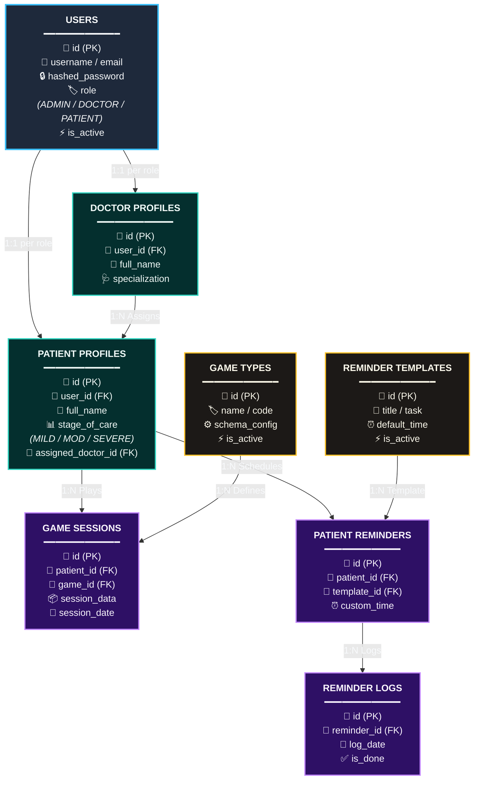

# Dementia Care API - SIH 2026
* **URL:**
  * Online Server: (Available 24/7, Temporary Memory) <br>
    https://dementia-care-yne7.onrender.com
  * Local Server: (Running from my machine, Permanent Memory) <br>
    https://blazer-roaming-sapling.ngrok-free.dev/
* **Documentation:** https://dementia-care-yne7.onrender.com/docs  
  *(`/docs` provides you with access to endpoints directly in the browser. You can test out the server there to get an idea about JSON strings.)*
  <br>
* **Miscellaneous:**
  * [SIH Official PPT Link - **DO NOT SHARE**](https://1drv.ms/p/c/c3d52faaccdd0da3/IQCOI5O-pVHQSIkZ9-ftQqmwAaxSdVtsL0JXLOyf1YbGNxA?e=rZJXHc)
  * [Notion Link](https://silly-hail-f25.notion.site/SIH-2026-3c8b1ece5c6880fb9088f338a17a3a51?source=copy_link)
  * [Hosting Site Dashboard](https://dashboard.render.com/)

---

### 🚨 Found a bug?
Report all minor bugs, tweaks, unintentional behaviour, grammatical errors. <br>
If you see a **500 Internal Server Error**, or any error starting with **5**, please message me since it indicates a server-side issue. Send me:
1. **The endpoint**
2. **The JSON body**
3. **The error message**


---

### Free server limitations:
* The first request takes 30–50 seconds to wake up the server, according to the website.
* The server will automatically reset after 15 minutes of inactivity. If you want to permanently store some data, let me know. I will manually place it in the database.
* Why it's online: So the API is accessible without you having to download this repo and set up the virtual environment for it.
* The local server stores data, but only available when my computer is running and connected to internet. Data will be available to the Online Server on the next commit.
---

<br>

# Endpoints & Schemas

### `GET /`
To verify if the server is awake and responding.
* **Parameters:** None
* **Success:** `200_OK`

---

### `POST /api/auth/register`
Registers a new user account across any role (`PATIENT`, `DOCTOR`, or `ADMIN`).
* **Parameters:** None
   <br> *(will require admin account to access in future)*
* **Success:** `201_CREATED`
* **Client Errors:** 
  * `HTTP_409_CONFLICT`: EMAIL_ALREADY_EXISTS
  * `422_UNPROCESSABLE_CONTENT`: ASSIGNED_DOCTOR_NOT_FOUND 

**JSON Body:**
* `email` *(string, required)*: Must be unique.
* `password` *(string, required)*: Plain text password. Simple strings allowed for testing.
* `role` *(string, required)*: `PATIENT`, `DOCTOR`, or `ADMIN`.
* `full_name` *(string, required)*: Display name.
* `specialization` *(string, optional)*: Used only when role is `DOCTOR`.
* `stage_of_care` *(string, required for patients)*: `MILD`, `MODERATE`, or `SEVERE`.
* `assigned_doctor_id` *(integer, optional)*: Must match a valid doctor's `user_id`.

**Example:**
``` json
{
  "email": "patient1@gmail.com",
  "password": "qwerty123",
  "role": "PATIENT",
  "full_name": "John Denver",
  "stage_of_care": "MILD",
  "assigned_doctor_id": 1
} 
```

---
<br>

# Database Schema

Might change if I find some fields unnecessary. However, I have begun to use some of them so there is little chance the following tables will change now:
 - Users
 - Doctor Profiles
 - Patient Profiles


---

